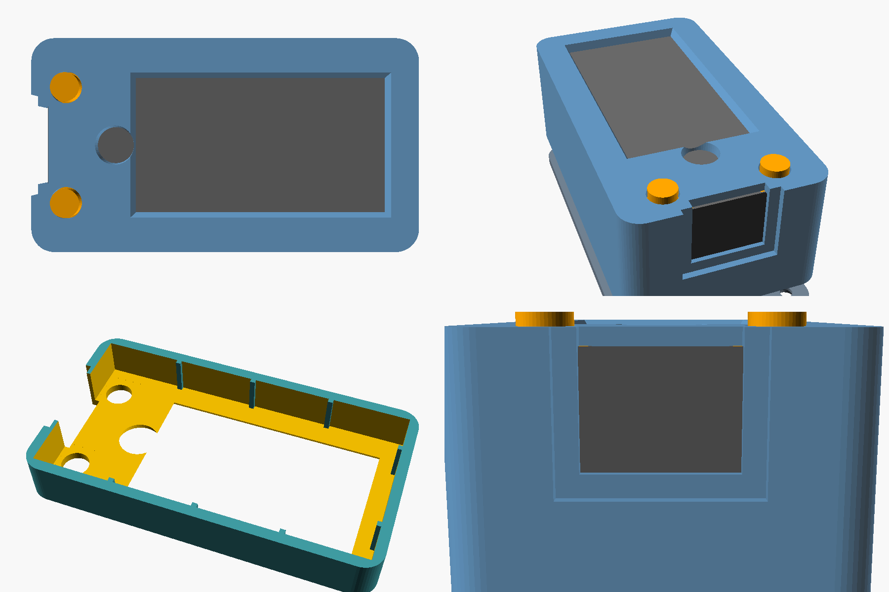

# Prototype case: LilyGO T-Display-S3 Touch + 803040 battery



A 3D-printed case in five parts (from r24):

- **body**: the walls, the battery bay with its screw posts, and a reset
  press tab in the side wall. Open at the front and the back.
- **separator**: a flat plate that drops into the body and sits between the
  board and the battery (notch for the battery wire).
- **faceplate**: the front frame (window, button holes) and the top few mm of
  the walls. Snaps over a tongue on the body. This is the part to print in
  different colours.
- **lid**: closes the battery bay. Snaps on (a tab at each end clicks into the
  end walls); four optional M2 screws (pan-head or self-tapping) hold it harder.
- **buttons**: the BOOT and KEY plungers. Those buttons are on the board's
  face either side of the USB port, so caps poke through the faceplate.

Outer size about **66 x 36 x 24 mm**.

| File | What |
|---|---|
| `lilygo_case.scad` | Parametric OpenSCAD model; edit the values at the top |
| `export.sh` | Exports all parts with a revision number and description |
| `stl/body_rNN_*.stl` | Print as exported (back on the bed); no supports |
| `stl/faceplate_rNN_*.stl` | Print face-down (front on the bed); no supports |
| `stl/separator_rNN_*.stl` | Flat plate |
| `stl/lid_rNN_*.stl` | Print flat, outside face (with the foot recesses) on the bed; snap tabs up |
| `stl/buttons_rNN_*.stl` | Face button plungers and the reset button, cap/stem-down; no supports |
| `stl/inlay_rNN_*.stl`, `stl/badge_plate_*`, `stl/badge_letters_*` | Print two (one for each side). One file with a colour change, or plate + letters as two parts for two filaments |
| `stl/shell_*`, `stl/fitcheck_*` | r01-r23: one-piece shell and quick fit check (superseded) |

`print/battlebuddy_rNN_all-parts_one-plate.3mf` has every part laid out on one
180 x 180 mm plate (Bambu A1 mini) in print orientation: body, faceplate, lid,
separator, buttons in three lengths (each set with a reset button) and two
badges. Two-colour pieces load as one object with two parts: the faceplate
with its A/B letters (from r32), and each badge with its letters. Set the
letters part to a second filament. `./make_3mf.py <rev> <description>` rebuilds
it after an export.

Use the files with the highest revision number. Older revisions stay so every
print can be traced back to its design.

### Revisions

| Rev | Change |
|---|---|
| r01 | First case: long side slots, separator floor, screw-on lid |
| r02 | Printed side buttons and a reset pinhole |
| r03 | Bigger USB opening, separator plate, buttons on any edge |
| r04 | Face buttons beside USB, Touch board size 62 x 32 x 11 |
| r05 | Screen-only window, circle key hole, crush ribs, lower USB, quick fit check |
| r06 | Face buttons 1.5 mm further out, circle key inside one larger bevelled window, ribs 0.8 → 0.35 mm |
| r07 | Rounded, recessed USB-C slot (closed, 12.5 × 7.2) instead of an open notch; window trimmed 1.2 mm at the far end to hide the bezel |
| r08 | Window far edge in another 1.6 mm (r05 print showed ~3 mm of bezel there); USB slot 0.3 mm higher to centre on the port |
| r09 | Slimmer: walls 2.0 → 1.6, front 1.6 → 1.2, lid 1.8 → 1.4, separator 1.6 → 1.2, 1 mm front-edge chamfer, board pocket 0.25 mm clearance; ribs squeeze 0.08 mm (end ribs push the board against the USB end); buttons ±10.75; USB slot just for the plug shell (9.6 × 4.2), wall thinned to 0.8 mm from inside |
| r10 | Thin frame: new window_style "border" shows most of the glass's black border (3 mm past the display each side, 2.5 mm at the far end); meant for black filament |
| r11 | Rounded window corners (r = 2.5, follows the glass) and 0.5 mm less at the far end (r10 corners showed a gap); circle key covered (`cover_key`); buttons ±10.3; USB slot 0.5 mm toward the front |
| r12 | Buttons asymmetric (−9.3 / +7.3: the board's switches are off-centre); round 6 mm notch off the window over the circle key so it can be pressed (`key_notch`) |
| r13 | Key notch replaced by a curved (half-ellipse) USB end on the window: full width at the corners, sweeping out to just past the circle key (`key_arch`) |
| r14 | Back to a plain rounded-rectangle window, now reaching as close to the buttons as they allow (key ring at the window edge); buttons −9.8 / +8.3. Extra `fitcheck_r14_variant-key-covered.stl` with the key covered |
| r15 | Window tongue reaching between the two face buttons toward USB (`key_tongue`), as wide as the button holes allow (0.8 mm plastic each side), tip 4 mm from the board end |
| r16 | Window + tongue as one outline with every corner rounded (2 mm fillets, inside corners too), tongue wider/further (0.7 mm web, tip 3 mm from the board end); button plungers 1.4 mm longer (switch tops ~3.2 mm below the glass), plus ±0.4 mm length variants |
| r17 | Tongue off: window ends at the glass edge again (as r14). Face buttons slimmed: 6.2 mm round flange under the frame + 3 mm stem to the switch (the 6.5 × 8 block hit the display), printed cap-down; ±0.4 mm length variants |
| r18 | Window USB edge 0.7 mm closer to the buttons (smaller 0.5 mm slope on that edge keeps ~0.85 mm of plastic by the holes); button flange cut flat on the display side (it hit the acrylic); plungers 1.65 mm longer (switch tops ~4.85 mm below the glass), ±0.5 mm variants |
| r19 | Plunger length set to the r18 shorter variant (switch tops 4.35 mm below the glass); flange only on the USB-side half (nothing toward the acrylic); caps 5 → 4.4 mm; window USB edge another 1 mm closer with a straight edge there (~0.6 mm plastic by the holes); ±0.3 mm length variants |
| r20 | Buttons 0.5 mm toward USB and 0.5 mm toward +y (down, USB on the right): −9.3 / +8.8 at 3.0 from the board end; window follows 0.5 mm; plungers 0.8 mm shorter (switch tops 3.55 mm below the glass); caps stand 2.2 mm proud (was 1.2); far-end ribs +0.15 mm for the lengthwise slop |
| r21 | Buttons on one line 2.75 mm from the board end, −8.8 / +9.05 (top 0.5 mm down, bottom 0.25 mm down, both 0.25 mm toward USB); window USB edge 0.4 mm closer (~0.5 mm plastic by the holes); reset pinhole slot in the +y wall (estimated position); fit check’s full-depth USB end now 14 mm long so it includes the reset slot |
| r22 | Full-case print. Buttons 0.5 mm up (−9.3 / +8.55); caps 4.4 → 4.0 mm (flange 5.4) so the wall between each hole and the window is ~0.2 mm thicker with the window unchanged; reset slot 0.5 mm toward the front; ±0.3 mm button variants |
| r23 | Reset is now a flexing press tab moulded into the +y wall (`rst_style = "flex"`): 6.5 × 4 mm tab cut free on three sides, hinged toward the far end, recessed 0.6 mm (1 mm thick so it bends), small nub inside on the switch. Pinhole slot still available (`"pin"`). Fit check full-depth USB end 18 mm to include it |
| r24 | **Split so it can be assembled:** body + snap-on faceplate (seam 2.5 mm below the front frame, tongue with snap ridges) + separate separator plate on ledges, so the board goes in from the front. Domed bump on the reset tab. Ribs stop below the seam |
| r25 | Faceplate held by barbed snaps (flat catch, sloped entry) + pry notch at the far end; window bevel 0.8 mm on all four sides incl. the USB side; separator has a window under the back connectors (battery plug reachable from the bay) and rails along the board edges (`conn_h` estimate, 3 mm); reset is now a small T-shaped button through the wall; "BATTLE BUDDY" recess on the −y wall + `inlay` part; bay takes up to an 803050 |
| r26 | Side label is a one-piece badge: 56 × 7.6 mm rounded recess (0.8 deep) + badge plate 0.6 mm with letters raised 0.4 mm (two-colour print with a colour change) |
| r27 | Reset button reaches ~1.75 mm in (nub 1.7) and stands 1.5 mm proud; separator rails off (the PCB is ~2 mm narrower than the glass each side), 2 mm pad under the board's far end instead; face plungers 0.8 mm longer, ±0.4 variants. Body, faceplate, lid unchanged |
| r28 | Lid snaps on (tab + barb at each end, grooves in the end walls, pry notch), screw holes kept for plain pan-head M2, chamfered lid edge; face buttons keyed (flat on the display side so they can't turn), tighter (0.15 mm), 0.4 mm longer; circle key covered with a plain rounded window; undo / menu symbols pressed into the faceplate beside the buttons; badge recess on both long sides (44 × 6.8 mm, toward the far end clear of the reset button) |
| r29 | Lid: channel round the outside face (1.6 wide, 1.0 deep, inside the screw holes) for thin silicone cord or strip instead of stick-on feet; lid 1.4 → 1.8 mm. Only the lid changed |
| r30 | Lid grip: two straight dovetail channels along the long sides (4 mm wide at the opening, 4.6 at the bottom, 1 mm deep, 47.7 mm long) for strips of silicone sheet, instead of one loop. Only the lid changed |
| r31 | Faceplate: neutral "A" (top) and "B" (bottom) letters beside the buttons instead of undo / menu symbols, since what they do can be remapped. Only the faceplate changed |
| r32 | Faceplate A/B letters 0.6 mm deep (3 layers) and exported as their own part (`faceplate_letters`) to fill them in a second colour; `make_3mf.py` builds the one-plate 3MF with faceplate + letters and badges as two-part objects |

(r01-r04 weren't exported with revision names; they're in git history.)

## Measure first

The Touch version is listed as 62 x 32 x 11 mm, but button and USB positions
aren't published. Before a full print, measure your board (or print
`fitcheck.stl`) and edit these in `lilygo_case.scad`:

- `board_l`, `board_w`, `board_t`: thickness including the touch glass and the
  parts on the back.
- `tail_l`: how far the bare board sticks out past the glass at the USB end.
- `active_from_far`, `key_from_glass`: where the display and the circle touch
  key sit on the glass. The front frame covers the glass's black border and
  shows only the display, with a small round hole for the key
  (`window_style = "glass"` shows the whole glass instead).
- `usb_from_front`: front of the glass to the centre of the USB-C port.
- `glass_drop`: from the front of the glass down to the board's top surface.
- `switch_h`: how tall the face buttons stand above the board.
- `buttons`: where each button is. The defaults put BOOT and KEY on the face,
  3.5 mm from the USB end and 10 mm either side of centre. **These are
  estimates from product photos.** Edge buttons (`"left"`, `"right"`, `"end"`)
  and recessed pinholes (`"pin"`) are also supported.
- If the caps don't click, lower `switch_h` a little so they reach further.

Then export a new revision (it never overwrites an existing one):

```sh
./export.sh 6 short-description-of-the-change
```

## Assembly

1. Push the reset button into its hole in the side wall from the inside
   (stem out, head in the pocket).
2. Drop the separator plate into the body from the front, rails up, the window
   at the USB end. It rests on the screw posts and small ledges.
3. Plug the battery lead into the board (check polarity: red to +), feed it
   down through the separator's window, and set the board screen-up on the
   rails, USB end first so the port lines up with its slot.
4. Put the two face buttons into the faceplate's holes from the inside.
5. Press the faceplate on until it clicks over the body's barbs. To take it
   off, pry at the notch on the seam at the far end.
6. Lay the battery in the bay from the back and press the lid on until both
   ends click (pry at the notch at the far end to open). Screws optional.
   For grip, cut two strips of 1-1.5 mm silicone sheet (or anti-slip tape)
   4.6 x 47 mm and press one into each channel on the lid's outside face; the
   channels are dovetailed, so the strips stay without glue.
   (`grip_channel = false` gives the old 8 mm foot recesses.)
7. Optional: tape or glue a badge into each side recess.

To reset the board, press the small button on the side wall.

Thin crush ribs on the inside walls squash as the board goes in so it sits
snug (`rib`; shave them with a knife if it's too tight). If it still rattles,
a strip of foam tape behind it takes up the slack.

## Quick fit-check print settings

Draft quality is fine; it only has to show whether things line up.
0.28 mm layers, 2 walls, 3 top/bottom layers, 15% infill, no supports, no brim,
your printer's fast or draft speed. Print it face-down (the STL is already
oriented that way).

## Notes

- The USB-C opening is 13 x 8 mm with the wall thinned around it so the plug's
  moulded housing can get close enough to seat. If a chunky cable still won't
  click in, raise `usb_relief` or use a slimmer cable.

- PLA or PETG, 0.2 mm layers. The floor between board and battery bridges
  about 32 mm, which most printers handle.
- The battery must have a **JST 1.25 mm** (MX1.25) plug for the LilyGO. Listings
  often default to PH2.0, which won't fit.
