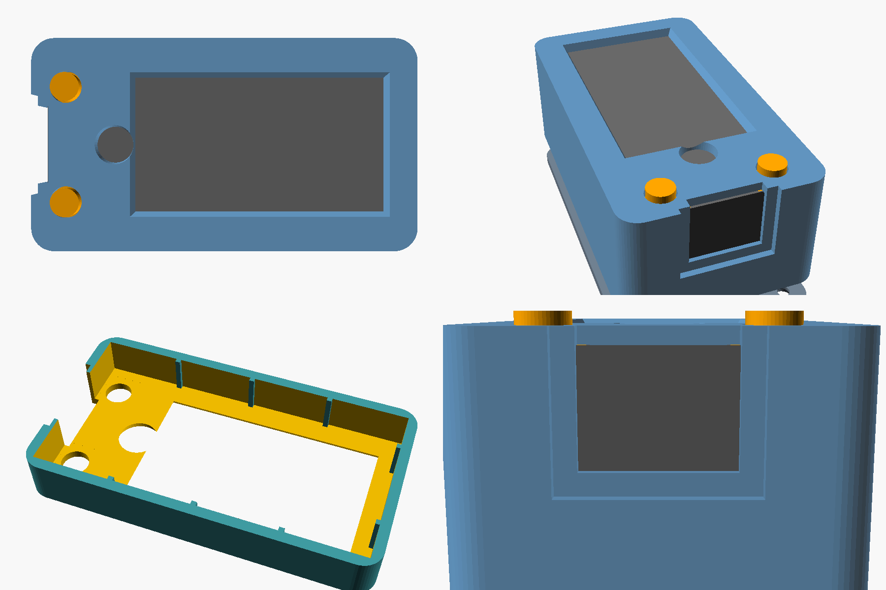

# Prototype case: LilyGO T-Display-S3 Touch + 803040 battery



A 3D-printed case: a **shell** that holds the board face-down behind a front
window with the battery in its own bay underneath (a printed separator plate
keeps them apart, with a small notch for the wire), a **lid** that screws on
with 4 x M2 x 6 self-tapping screws (remove it to swap the battery), and
**button caps**: the T-Display-S3's BOOT and KEY buttons are on its face,
either side of the USB port, so the front frame covers that bare end of the
board and two round caps poke up through it and sit on the buttons (no
membrane needed). Outer size about **67 x 37 x 25 mm**.

| File | What |
|---|---|
| `lilygo_case.scad` | Parametric OpenSCAD model; edit the values at the top |
| `export.sh` | Exports all parts with a revision number and description |
| `stl/shell_rNN_*.stl` | Print face-down (front on the bed), no supports |
| `stl/lid_rNN_*.stl` | Print flat, countersinks on the bed |
| `stl/buttons_rNN_*.stl` | The press caps, laid out flat; no supports |
| `stl/fitcheck_rNN_*.stl` | Front frame with short walls plus the USB end at full depth (~5 g); for checking fit fast |

Use the files with the highest revision number. Older revisions stay so every
print can be traced back to its design.

### Revisions

| Rev | Change |
|---|---|
| r01 | First case: long side slots, separator floor, screw-on lid |
| r02 | Printed side buttons and a reset pinhole |
| r03 | Bigger USB opening, separator plate, buttons on any edge |
| r04 | Face buttons beside USB, Touch board size 62 x 32 x 11 |
| r05 | Screen-only window, circle key hole, crush ribs, lower USB, quick fit check |
| r06 | Face buttons 1.5 mm further out, circle key inside one larger bevelled window, ribs 0.8 → 0.35 mm |
| r07 | Rounded, recessed USB-C slot (closed, 12.5 × 7.2) instead of an open notch; window trimmed 1.2 mm at the far end to hide the bezel |
| r08 | Window far edge in another 1.6 mm (r05 print showed ~3 mm of bezel there); USB slot 0.3 mm higher to centre on the port |

(r01-r04 weren't exported with revision names; they're in git history.)

## Measure first

The Touch version is listed as 62 x 32 x 11 mm, but button and USB positions
aren't published. Before a full print, measure your board (or print
`fitcheck.stl`) and edit these in `lilygo_case.scad`:

- `board_l`, `board_w`, `board_t`: thickness including the touch glass and the
  parts on the back.
- `tail_l`: how far the bare board sticks out past the glass at the USB end.
- `active_from_far`, `key_from_glass`: where the display and the circle touch
  key sit on the glass. The front frame covers the glass's black border and
  shows only the display, with a small round hole for the key
  (`window_style = "glass"` shows the whole glass instead).
- `usb_from_front`: front of the glass to the centre of the USB-C port.
- `glass_drop`: from the front of the glass down to the board's top surface.
- `switch_h`: how tall the face buttons stand above the board.
- `buttons`: where each button is. The defaults put BOOT and KEY on the face,
  3.5 mm from the USB end and 10 mm either side of centre. **These are
  estimates from product photos.** Edge buttons (`"left"`, `"right"`, `"end"`)
  and recessed pinholes (`"pin"`) are also supported.
- If the caps don't click, lower `switch_h` a little so they reach further.

Then export a new revision (it never overwrites an existing one):

```sh
./export.sh 6 short-description-of-the-change
```

## Assembly

1. Plug the battery into the board (check polarity: red to +).
2. Drop the two button caps into their holes from the inside, caps out.
   Their inner blocks are bigger than the holes, so the board holds them in.
3. Drop the board face-down into the shell, screen against the window.
4. Route the battery wire through the slot in the floor and lay the battery
   in the bay.
5. Screw the lid on. Stick four 8 mm rubber feet into the recesses.

Thin crush ribs on the inside walls squash as the board goes in so it sits
snug (`rib`; shave them with a knife if it's too tight). If it still rattles,
a strip of foam tape behind it takes up the slack.

## Quick fit-check print settings

Draft quality is fine; it only has to show whether things line up.
0.28 mm layers, 2 walls, 3 top/bottom layers, 15% infill, no supports, no brim,
your printer's fast or draft speed. Print it face-down (the STL is already
oriented that way).

## Notes

- The USB-C opening is 13 x 8 mm with the wall thinned around it so the plug's
  moulded housing can get close enough to seat. If a chunky cable still won't
  click in, raise `usb_relief` or use a slimmer cable.

- PLA or PETG, 0.2 mm layers. The floor between board and battery bridges
  about 32 mm, which most printers handle.
- The battery must have a **JST 1.25 mm** (MX1.25) plug for the LilyGO. Listings
  often default to PH2.0, which won't fit.
