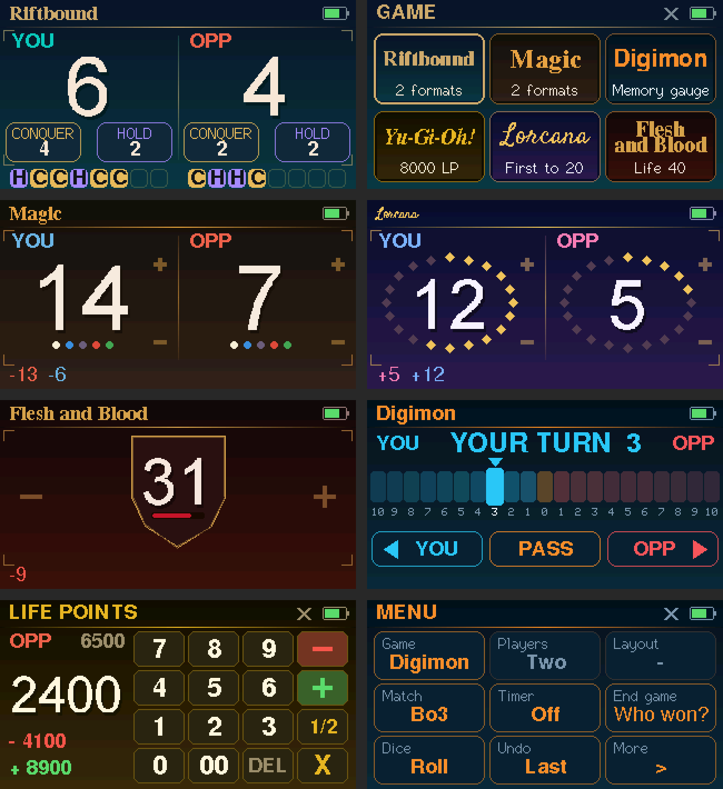

# BattleBuddy: LilyGO T-Display-S3 Touch prototype

A single-player counter running on the T-Display-S3 Touch (1.9" 170×320 LCD,
CST816 capacitive touch, ESP32-S3). The counter logic lives in
[`core/`](../../core) and is shared with future boards.



## Controls

Hold the board landscape, USB port on the right.

| Input | Action |
|---|---|
| **BOOT** button, short press | Open / close the menu (or leave the dice) |
| **BOOT**, hold 1 s | Sleep |
| **KEY** button | Undo (shows what was undone); rolls on the dice screen; closes the menu; wakes from sleep |
| Circle below the screen | Open / close the dice |

**Menu:** tap a tile; tap the header to close. The menu has two pages.

| Tile | Does |
|---|---|
| Game | Opens the game picker: one tile per game, in that game's colors and lettering. Games with several formats (Riftbound 1v1 / 2v2, Magic Standard / Commander) burst open into format tiles; tap one to start. BOOT or the header steps back |
| Players | *Just you*, *Two*, *Three*, *Four* (team games: one or two teams) (restarts) |
| Layout | Two players: *YOU left*, *YOU right*, or *Facing* (opponent upside down along the top, for a device lying between you). Three or four: *Upright* or *Facing* (top row upside down) |
| Match | *Off*, *Bo1*, *Bo3*, *Bo5*. One or two sides only |
| Timer | *Off*, *30*, *50*, *60 min* countdown; starts with the first point |
| Restart / End game | Without a match: start over. With a match: *Who won?* lets you pick the winner (for games the counter can't decide, like Digimon, or a concession), or restart without a result |
| Dice | Opens the dice |
| Undo | Undoes the last change (same as KEY) |
| More → Look | *Subdued* (the game's palette as is) or *Vivid* (more saturated colors and glowing text) |
| More → Counter | For plain life counters (Magic, Commander, Lorcana, FaB). *Themed* (default): each game's own look, below. *d20*: life on a d20 that spins a face toward each change. *Digits*: just the number |
| More → Flip | Rotates the whole screen 180° (USB port on the left) |
| More → Sleep | Sleep now; KEY wakes |

**Themed counters:** Magic and Commander show a quiet row of five colored
dots under life; on a change they ripple and the number briefly tints red
(damage) or green (gain). Lorcana surrounds lore with a diamond for each point toward
20, lighting up as lore is gained, with a sparkle on the newest. Flesh and
Blood sets life on a bronze shield with a blood bar for how much is left; it
shakes and flushes red when hit. Numbers roll like an odometer when they
change, and Yu-Gi-Oh! LP count down (or up) to the new total.

**Matches and the timer:** when a game is decided (someone reaches the win
target, or a life total hits 0), a banner shows who won the game and the match
score. Tap to start the next game, or a new match once someone has won it.
Undo before tapping if the result was a mistake. The match score and the
countdown sit in the header (or a small pill on the middle line in facing and
four-player layouts). The clock turns gold under 5 minutes and red with a `+`
once time is up. It keeps running while the board sleeps.

**Dice:** pick Coin, d4, d6, d8, d10, d12 or d20 along the top, then tap
anywhere (or press KEY) to roll. Each die moves its own way: the d4 hops,
the d6 rolls in from the left, the d8 spins like a top, the d10 swings, the
d12 is tossed in an arc, the d20 is thrown toward you, and the coin flips.
Every landing pops with a ring and sparks,
colored cool for low rolls and warm for high ones. The top face is a
celebration (confetti, "NAT 8!") and a 1 throws embers ("NAT 1"). The last few rolls are listed along the
bottom. Rolls use the ESP32's hardware random number generator with no bias
between faces. Good for casual play; at a sanctioned event, use physical dice.

**Counting:**

- Riftbound: tap **CONQUER** or **HOLD** to score a point of that kind. Every
  point is recorded on its own, right away. A row of 8 slots per player fills
  with **C** / **H** in the order the points were scored, so you can see
  exactly how each point was earned. Mistakes are fixed with undo.
- Other games, one player: left third −, right third +, middle switches the
  step between 1 and 5. Hold to repeat.
- Other games, two players: side by side, top half of a player's side +1,
  bottom half −1; facing, left third −1, right third +1 of your own strip.
- Three or four players: each quarter has its own CONQUER/HOLD buttons (C/H)
  or −/+ sides.
- Digimon: a shared memory gauge from YOU's 10 to OPP's 10. Tap a spot on the
  gauge to jump there, or use the YOU / OPP arrows (hold to repeat). The
  marker's side shows whose turn it is (it stays with that player at 0).
  PASS leaves the opponent 3 memory.
- Yu-Gi-Oh!: 8000 LP. Tap a player to open the number pad, type the amount,
  then − (damage) or + (gain). 1/2 halves that player's LP; DEL deletes a
  digit; X or BOOT closes without changing anything. Each entry is one
  history entry, so undo reverses it exactly.
- Riftbound 2v2 keeps one score per team, to 11. (The 11 is my assumption;
  it's one number in `core/src/profile.c`.)

Taps act when your finger lifts. A touch is ignored if a side button is
pressed during it or just before it, so grazing the screen while reaching for
a button doesn't score anything. CONQUER/HOLD only respond to taps on the
button itself; tapping between them does nothing.

For games other than Riftbound, quick taps are grouped: changes within 1.5 s
of each other show as a pending `+3` / `-2`, then become one history entry
along the bottom (colored by player in two-player mode).

Each game has its own colors and its own title lettering. The screen dims after 30 s idle and the
board sleeps after 10 minutes; the first touch or press after dimming only
wakes the screen. The game survives sleep, but not a reset or power cut.

## Build and flash

Needs [PlatformIO](https://platformio.org/install) (VS Code extension or `pip install platformio`).

```sh
cd firmware/tdisplay-s3
pio run -t upload
pio device monitor   # optional serial log
```

If the upload can't find the board, hold BOOT, press and release RST, then
release BOOT and run the upload again.

## Things to check on first boot

These were set from LilyGO's pin map but haven't been tested on hardware yet:

- **Orientation:** if the picture is upside down, change `lcd.setRotation(1)`
  to `3` in `src/main.cpp`.
- **Touch alignment:** if taps land on the wrong side, adjust
  `offset_rotation` in `src/display.h` (try 1, 2, 3).
- **Battery reading:** the top-right shows a lightning bolt above 4.3 V (USB),
  otherwise a rough charge level. Plug in a LiPo and compare.
- **Circle key:** the serial monitor prints `touch raw x=.. y=..` for every
  touch. The circle should report y ≥ 320; if it reports something else, change
  `kRawHomeKeyY` in `src/main.cpp`. Tapping it should open the dice.

## Previewing the UI without hardware

`snapshot/` renders the screen for a few game states using the same drawing
code, on a Linux/macOS host:

```sh
cd firmware/tdisplay-s3
pio run                 # downloads LovyanGFX into .pio/
make -C snapshot        # writes PPM images to snapshot/build/
```
